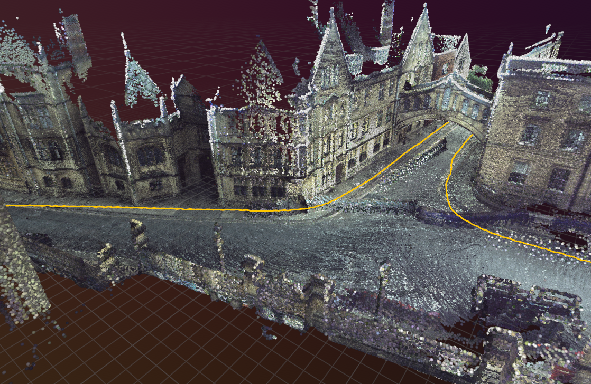
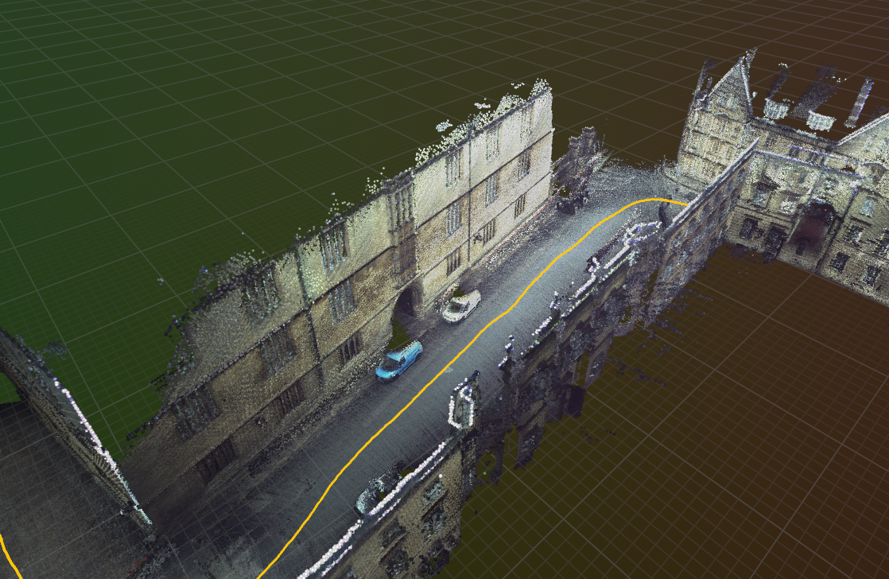
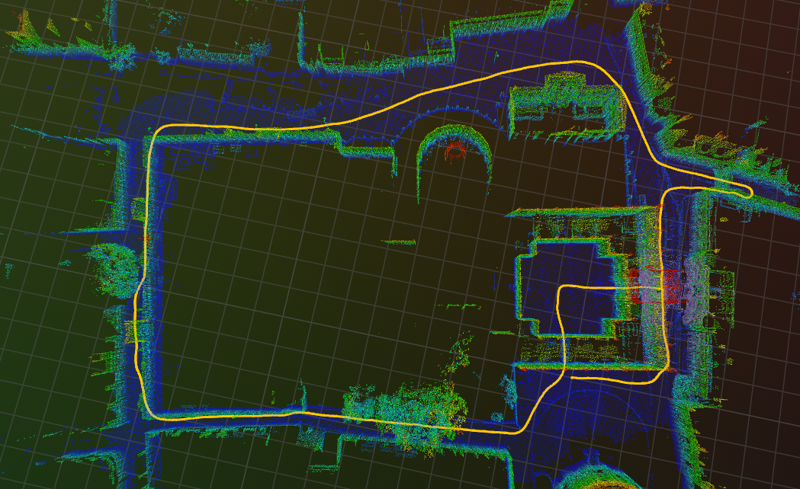
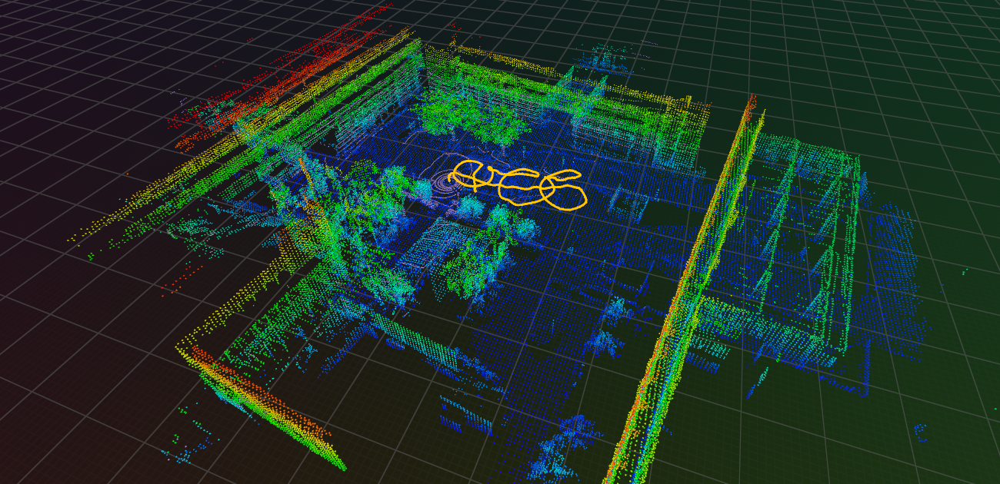

# livo-slam

A LiDAR-visual-inertial odometry and mapping system. An iterated extended Kalman
filter holds a 19 element error state. It fuses the lidar scan and then the
camera image into each update.

The map is a voxel map with an octree in each voxel. The lidar update matches
points to planes. The camera update is a direct photometric update on image
patches. The filter also estimates the camera exposure.



The camera gives each map point its color. The yellow line is the path.

|                                                                   |                                                               |
| ----------------------------------------------------------------- | ------------------------------------------------------------- |
|  |  |
| A street in Oxford Spires, with camera color.                     | The same sequence from above. The color shows the height.     |
|                 |                                                               |
| NTU VIRAL eee_03.                                                 |                                                               |

## Sensors and data

- IMU: `sensor_msgs/Imu`
- Lidar: `sensor_msgs/PointCloud2` or Livox `CustomMsg`
- Camera: `sensor_msgs/Image` or `sensor_msgs/CompressedImage`, mono or color

The camera model supports the radtan and the equidistant (fisheye) distortion
models.

## Requirements

- Docker
- VS Code with the Dev Containers extension

Do not install anything on the host. All builds operate in the container.

## Build

Open the repository in VS Code. Then run **Dev Containers: Reopen in
Container**. The first start takes some minutes.

In the container terminal:

```bash
cmake --preset relwithdebinfo
cmake --build --preset relwithdebinfo
ctest --preset relwithdebinfo
```

The first configure step gets and builds the dependencies. This takes some
minutes. You can also use `release` or `debug`, or push `F7` in VS Code.

The build output goes to `build/<preset>/`.

Build options:

- `LIVO_SLAM_BUILD_TESTS` (default `ON`)
- `LIVO_SLAM_ENABLE_RERUN` (default `ON`). `OFF` removes the dependency and
  makes each visualizer function empty.

## Run

Push `F5` in VS Code. It asks you which dataset to use, builds the code, and
starts the node in the debugger.

To start the node yourself, give it a configuration file:

```bash
./build/relwithdebinfo/src/livo_slam --ros-args --params-file config/ntu_viral.yaml
```

`scripts/select_dataset.sh ntu_viral/eee_03_mcap` points `config/active.yaml`
and `datasets/active` at one dataset and sequence. `F5` uses this.

## Packaged image

```bash
docker build --target runtime -t livo-slam:runtime .
docker run --rm --network=host --ipc=host livo-slam:runtime
```

The entrypoint starts the Rerun viewer, waits for it, prints the URL, and then
starts the node. Host networking lets the browser find the viewer. Shared IPC
lets DDS speak to other containers.

Use these variables to change the defaults:

| Variable           | Function               |
| ------------------ | ---------------------- |
| `LIVO_SLAM_CONFIG` | The configuration file |
| `LIVO_SLAM_BAG`    | A recording to replay  |
| `RERUN_GRPC_PORT`  | The gRPC port          |
| `RERUN_WEB_PORT`   | The web viewer port    |

```bash
docker run --rm --network=host --ipc=host -v $PWD/datasets:/data \
  -e LIVO_SLAM_CONFIG=/opt/livo-slam/config/ntu_viral.yaml \
  -e LIVO_SLAM_BAG=/data/ntu_viral/eee_03_mcap livo-slam:runtime
```

The launcher waits until the node is in `ros2 node list`. Then it starts the
playback. At the end of the playback the container continues to operate, thus
you can examine the recording in the browser. Push Ctrl-C or use `docker stop`.

To give more arguments to the node, write the launcher name. Arguments after the
image name replace the default command, they do not add to it:

```bash
docker run --rm --network=host --ipc=host livo-slam:runtime \
  livo-slam-launch -p viz.enabled:=false
```
